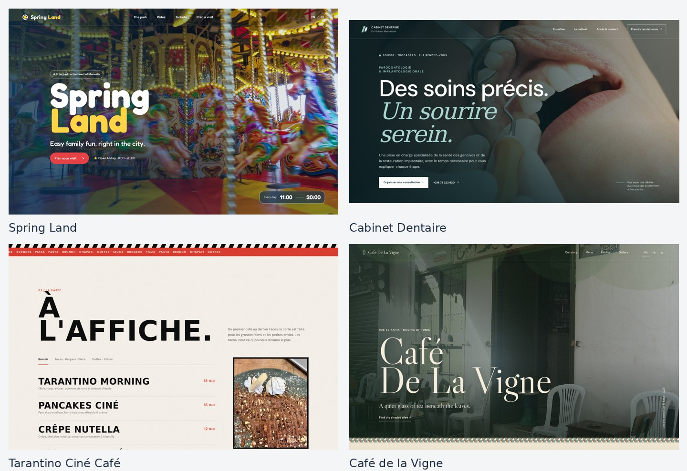

# Amine Zobaa

**Web developer · Monastir, Tunisia**

I build responsive business websites and practical web applications with React, TypeScript, Next.js, and Node.js or Python APIs.

[Discuss a freelance project](https://tunisiefreelance.tn/fr/profile/zobaa-a-b65c97) · [LinkedIn](https://www.linkedin.com/in/amine-zbaa-0750872a1/)

## What I can help you build

- **Business websites and landing pages:** clear services, useful contact actions, and layouts that work on phones and desktops.
- **React interfaces:** responsive pages, reusable components, forms, and improvements to an existing frontend.
- **Focused integrations:** connect an interface to a REST API or add a clearly scoped Node.js / FastAPI backend.

## Website portfolio

Four different visual directions for a leisure park, a dental practice, and two cafés. These examples show page structure, responsive design, service presentation, menus, and contact journeys.

[See the full portfolio and project descriptions](https://tunisiefreelance.tn/fr/profile/zobaa-a-b65c97).

## Selected software projects

| Project | What it demonstrates | Stack |
| --- | --- | --- |
| [FSM Navigator](https://github.com/zamine-dots/fsm-map) | Interactive campus maps, classroom search, suggested walking routes, and a personal timetable | React, TypeScript, Three.js, Zustand |
| [Sector Zero](https://github.com/zamine-dots/ctf-onboarding) | A guided learning interface with challenge tracking, local profiles, and JSON progress export/import | React, TypeScript, Vite, Tailwind CSS |
| [Event Distribution Manager](https://github.com/zamine-dots/EventPauseManager) | A QR-based participant dashboard, food/coffee collection tracking, and CSV exports | Next.js, TypeScript, SQLite |
| [BookListFull](https://github.com/zamine-dots/BookListFull) | Account flows, Open Library search, and a personal list of favorite books | React, Appwrite, Vite |

The repositories explain how to run each project and the limits of its current implementation.

## Background

I'm studying Computer Science at the **Faculté des Sciences de Monastir** (2024–2027). At **OneSpace**, I worked on reusable React/TypeScript components and responsive page interfaces. My research work also includes a FastAPI annotation tool and a PyTorch image-classification pipeline.

**Core tools:** React · Next.js · TypeScript · JavaScript · HTML/CSS · Node.js/Express · Python/FastAPI · Git · Docker

**Working languages:** Arabic, French, and English.

## Work with me

I'm open to freelance website projects, frontend fixes, and small API integrations. Share the pages or features you need, a reference you like, and your target date. We'll agree on scope, deliverables, and price before starting.

[Send a project brief on Tunisie Freelance](https://tunisiefreelance.tn/fr/profile/zobaa-a-b65c97).
